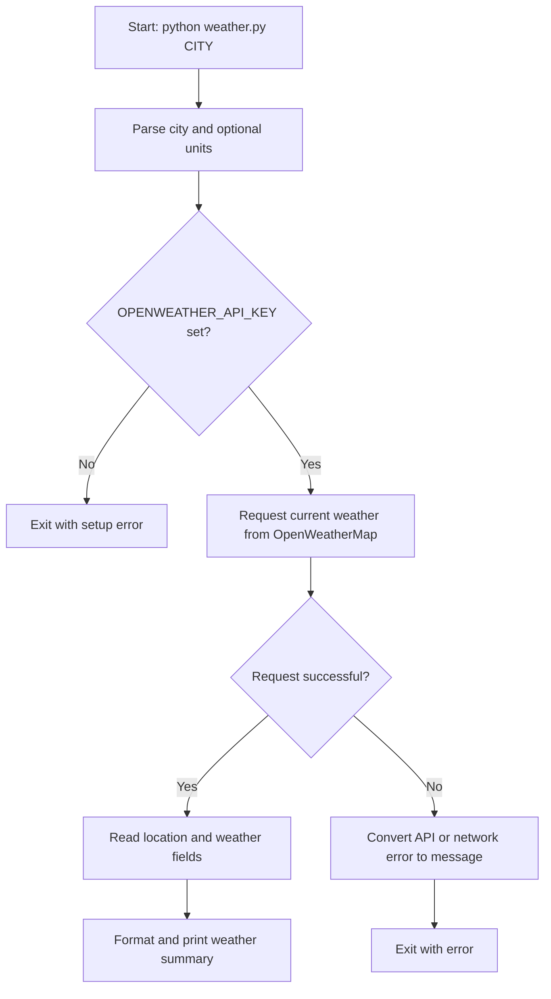

# Weather CLI App

A command-line application that retrieves the current weather for a city from
the [OpenWeatherMap Current Weather API](https://openweathermap.org/current).
It displays the city and country, temperature, feels-like temperature, weather
condition, and humidity.

## Requirements

- Python 3.9 or later
- An internet connection
- An OpenWeatherMap API key with access to the Current Weather API

## Installation

1. Open a terminal in the `Weather Cli App` directory.
2. (Optional, but recommended) Create and activate a virtual environment:

   ```bash
   python -m venv .venv
   ```

   macOS / Linux:

   ```bash
   source .venv/bin/activate
   ```

   Windows PowerShell:

   ```powershell
   .venv\Scripts\Activate.ps1
   ```

3. Install the Python dependency:

   ```bash
   python -m pip install -r requirements.txt
   ```

4. Create an API key in your OpenWeatherMap account. Newly created keys may
   take a while to become active.
5. Set the key in the environment for the current terminal session:

   macOS / Linux:

   ```bash
   export OPENWEATHER_API_KEY="your_api_key"
   ```

   Windows PowerShell:

   ```powershell
   $env:OPENWEATHER_API_KEY = "your_api_key"
   ```

   Keep the key private. Do not put it in the source code or commit it to the
   repository.

## Usage

Pass a city name as the positional argument. Use quotes when the name contains
spaces:

```bash
python weather.py Kolkata
python weather.py "New York"
```

Choose a unit system with `-u` or `--units`:

```bash
python weather.py London --units imperial
python weather.py "New York" -u standard
```

| Unit option | Temperature | Default |
| --- | --- | --- |
| `metric` | Celsius (°C) | Yes |
| `imperial` | Fahrenheit (°F) | No |
| `standard` | Kelvin (K) | No |

Run `python weather.py --help` to see the command-line options.

## Example

```text
Weather in Kolkata, IN
------------------------------
Temperature : 29.4°C (feels like 33.1°C)
Condition   : Haze
Humidity    : 74%
```

The reported values depend on the city and the current API response.

## Workflow



## Errors

The app prints an error and exits if the API key is missing or invalid, the
city cannot be found, the request times out, or the network/API request fails.
For an invalid or newly created key, confirm it is correct and allow time for
OpenWeatherMap to activate it.

## Project files

- `weather.py` — command-line argument parsing, API request, error handling,
  and output formatting.
- `requirements.txt` — Python package dependencies (`requests`).
